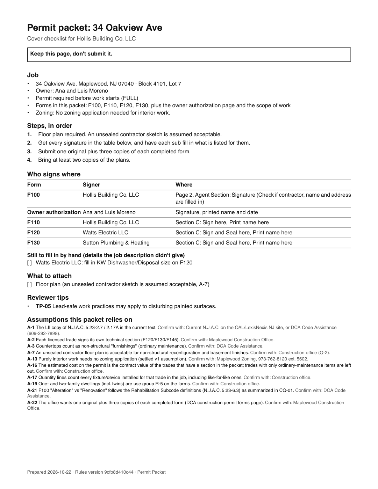
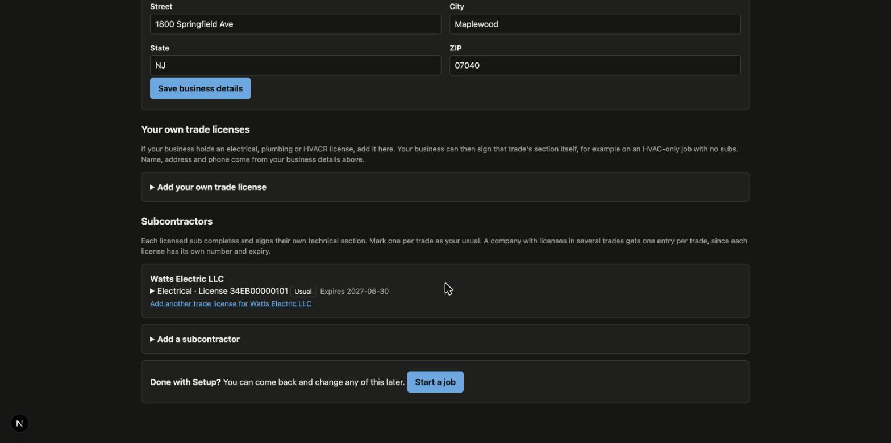
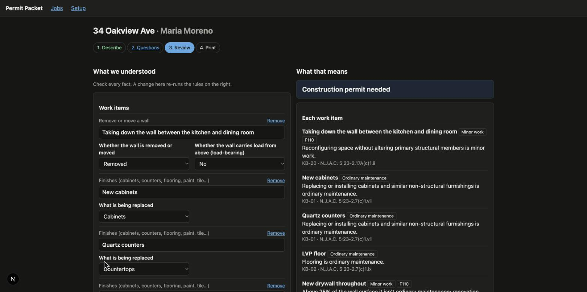
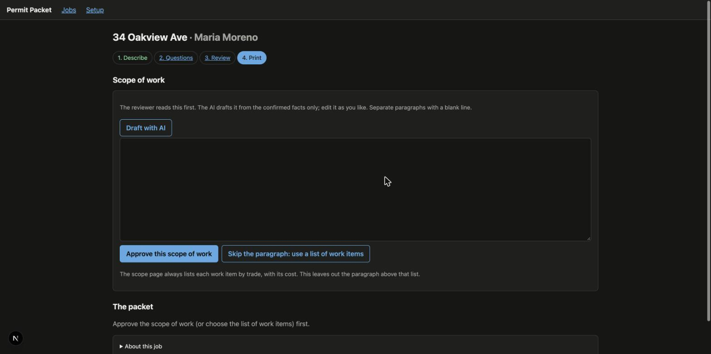

# Permit Packet

**Describe a home-improvement job in plain English. Get a complete, print-ready New Jersey construction permit packet.**

Permit Packet is a small app that runs on your own computer. A contractor types the address and a few sentences about the job ("full kitchen gut, taking out a non-load-bearing wall, new circuits, moving the sink..."). The app works out which permit forms are needed, fills in the official state forms, writes a scope of work for the plan reviewer, and prints a cover checklist that says who signs where and what still has to be attached.

It currently covers one town (**Maplewood, NJ**) and four kinds of residential work: kitchen and bath remodels, finished basements, roof replacement, and HVAC installation or replacement.

> **Read this first.** Permit Packet is an extended proof of concept, not a production product. It is unofficial, it is not legal advice, and it is not affiliated with the State of New Jersey or the Township of Maplewood. The applicant is always responsible for what is on a permit application. Check the packet, and confirm anything uncertain with the Maplewood Construction Office before you submit. See [What this is, and what it is not](#what-this-is-and-what-it-is-not).

Built by [Gregory Kelly](https://github.com/GregKelly).

---

## Contents

1. [The problem it solves](#the-problem-it-solves)
2. [What you get](#what-you-get)
3. [How it works](#how-it-works)
4. [Quick start](#quick-start)
5. [Using the app](#using-the-app)
6. [What this is, and what it is not](#what-this-is-and-what-it-is-not)
7. [Plain-English glossary](#plain-english-glossary)
8. [All commands](#all-commands)
9. [Where things are](#where-things-are)
10. [Privacy and cost](#privacy-and-cost)
11. [Troubleshooting](#troubleshooting)
12. [Project status](#project-status)
13. [License](#license)

---

## The problem it solves

In New Jersey, almost every residential renovation needs a construction permit. The paperwork usually falls to the contractor or their office manager, who fills out the state permit forms by hand, collects signatures, and carries the packet to the town's construction office.

Typing is the easy part. What goes wrong are the judgment calls:

- **What kind of work is this?** Repair, alteration, or minor work? Does it need a permit at all?
- **Which forms are needed?** A kitchen remodel can involve building, electrical, plumbing and fire sections.
- **Who has to sign what?** The owner, the contractor, and any licensed electrician or plumber each have their own signature spots.
- **What has to happen first?** In Maplewood, some work needs separate zoning approval before the permit is even accepted.
- **How should the work be described?** A reviewer needs to see exactly what is being done.

When any of these is wrong, the application is rejected or sent back with questions. That delays the job and costs unbilled time. Permit Packet makes each of those decisions visible, with the reason and (where possible) the code citation, before it fills in a single box.

## What you get

For each job, one PDF packet, printed on paper:

| Page(s) | What it is |
|---|---|
| **Cover checklist** (keep it, don't submit it) | The job in brief, the steps in order, a table of who signs where, anything still to fill in by hand, what to attach (plans, zoning approval), reviewer tips, and the assumptions the packet relies on |
| **F100** | The state's permit application form, filled in |
| **Technical sections** (F110, F120, F130, F145, F370 as needed) | The official building, electrical, plumbing, HVAC and fuel-fired-appliance forms, filled in |
| **Owner authorization** | A page for the property owner to sign, giving the contractor permission to apply |
| **Scope of work** | A plain description of the work for the plan reviewer, with costs by trade |

The forms are the State of New Jersey's own PDFs. The app only fills in the boxes; it does not redraw or alter the forms.

Here is the first page of a packet for a kitchen remodel (all names and numbers are made up):



## How it works

One rule runs through the whole design:

> **The AI interprets and writes. Rules decide. The contractor confirms.**

1. **The AI reads and writes.** The contractor's description goes to an AI model (Claude, from Anthropic). It pulls out the facts ("non-bearing wall removed," "$3,500 plumbing") and marks anything it can't tell as *unknown* rather than guessing. It also words follow-up questions and drafts the scope-of-work paragraph from confirmed facts only.
2. **Plain rules decide.** The decisions that matter are **not** made by the AI. A *rules engine* (ordinary, predictable code working from rule files you can read) decides the work classification, which forms are required, whether zoning approval is needed first, whether plans are needed, and what goes in the cost and quantity boxes. Every decision comes with its reason. The same input always gives the same output.
3. **The contractor confirms.** Nothing is final until the contractor has checked the facts and the decisions on the Review screen.

Why split it this way? An AI is good at understanding messy human language and bad at being consistently, provably right about legal requirements. Rules are the opposite. Each does what it is good at.

The rules live in readable files in the [`rules/`](rules/) folder, separate for state-level and Maplewood-level rules, so a town's requirements can be checked and changed without touching program code. The full set is printed in [`docs/rules-reference.md`](docs/rules-reference.md). Rules that are best guesses rather than confirmed facts are marked as **assumptions**, listed with how to confirm each one, and shown in the app and on the packet.

## Quick start

### What you need

- A **Mac, Linux or Windows computer** with a terminal. (It has been built and tested on a Mac.)
- **Node.js**, a free tool that runs this kind of program. Developed and tested on **Node 26**. The app uses Node's built-in database, so use a recent version. Check what you have with `node -v`; get Node from [nodejs.org](https://nodejs.org).
- **Git**, to download the project. ([Install instructions](https://git-scm.com/downloads))
- An **internet connection** while using the app, for the property lookup and the AI.
- *Optional:* an **Anthropic API key** so the AI features work. Without one, you can still use the app by filling in the job facts by hand, and you can still try the packet builder on the built-in test jobs. See [Privacy and cost](#privacy-and-cost).

### Option A: see a packet in about two minutes (no key, no cost)

This builds a packet from one of the project's ready-made test jobs. It makes no AI calls and costs nothing.

```bash
git clone https://github.com/GregKelly/nj-permit-packet.git
cd nj-permit-packet
npm install
npm run packet -- J-01
```

Open `out/J-01.pdf`. That is a complete sample packet (a $48,000 kitchen remodel with a wall removal).

Want to see the reasoning behind it in words? Run:

```bash
npm run determine -- J-01
```

### Option B: run the full app

1. Do the three commands above (`git clone`, `cd`, `npm install`) if you haven't already.
2. *(Optional, for the AI features)* Give the app your Anthropic API key. In the same terminal window:

   ```bash
   export ANTHROPIC_API_KEY="your-key-here"
   ```

   This lasts only for that terminal window. Never put the key in a file that goes into Git. (The project's `.gitignore` already keeps `.env` files and your saved data out.)
3. Start the app:

   ```bash
   npm run app
   ```
4. Open **http://127.0.0.1:3000** in your browser.

The app only listens on your own computer. Nobody else on your network can reach it. Stop it with `Ctrl+C` in the terminal.

The first time, you'll land on **Setup**. Follow [Using the app](#using-the-app).

### Check that everything works

```bash
npm test
```

This runs several hundred automated checks on the rules, the form filling, and the app. It makes **no** AI calls and costs nothing. All of them should pass.

## Using the app

The app has a Setup screen you use once, and four steps for each job.

### One-time Setup

Enter your business details (name, home-improvement-contractor registration number, tax ID, phone, email, address) and the licensed subcontractors you use: electricians, plumbers, HVAC contractors, each with a license number and expiry date. If your own business holds a trade license, add it too. Everything you enter here stays on your computer. None of it is sent to the AI.



### For each job

1. **Describe.** Type the street address and click *Look up block and lot*. The app finds the tax-record entry (block, lot, year built, number of units) for you to confirm. Pick the type of home, add the owner's details, and write the job description in plain words, the way you'd explain it to the owner. Click *Next*.
2. **Questions.** If the description leaves out something the rules need (for example, how big a new window is), the app asks, one plain-English question at a time. "Don't know" is always allowed, and the cover checklist then tells the right person to fill that box in. If nothing is missing, this step is skipped.
3. **Review.** The left side lists every fact the app understood, all editable. The right side shows what the rules decided: the permit type, each work item's classification, the forms needed, zoning, plans, and any warnings (for example, an expired subcontractor license). Each decision shows its reason and code citation. Change a fact on the left and the right updates. Click *Confirm* when it all looks right.

   
4. **Print.** The AI drafts the scope-of-work paragraph for you to read, edit and approve (or you can skip it and use a plain list). Then you can preview the packet, download the PDF, or print it.

   

After printing: get the owner's and subcontractors' signatures, attach whatever the cover checklist lists, and hand-deliver the packet to the construction office. The app does not submit anything for you.

## What this is, and what it is not

**It is an extended proof of concept.** It is a real, working application with a real rules engine, real official forms and a full test suite. It was built to find out whether this idea works and to learn how to build it well. It has been run on test jobs and checked by its author, but not yet by a wide group of contractors or by the permit office.

**It is not production software.** Specifically:

- **One town, four job types.** Maplewood, NJ only. Kitchen and bath, finished basements, roofs, HVAC. Commercial work, decks, additions and other towns are out of scope.
- **Not official and not legal advice.** The rules come from public sources (the NJ Uniform Construction Code, state guidance, Maplewood's zoning ordinance). Maplewood publishes no review checklist, so some rules are educated assumptions, flagged as such. A few questions are still open with the construction office (see [`docs/rules-table-v1.md`](docs/rules-table-v1.md), section 6).
- **No fees.** The town's office calculates fees, so those boxes are left blank.
- **No drawings.** When plans are needed, the packet says so. The app never creates them.
- **No electronic filing, no electronic signatures.** The output is paper.
- **No accounts, no security layer.** It is meant for one person on their own computer. Don't put it on a public server.
- **Not tested at scale.** No load testing, no monitoring, no multi-user support. Backups of your data (the `data/` folder) are up to you.
- **Depends on outside services.** The property lookup uses the state's public parcel data service, and the AI features use Anthropic's API. If either changes or is down, those parts stop working. (The manual path in the app keeps working without the AI.)

## Plain-English glossary

| Term | What it means |
|---|---|
| **Construction permit** | Official permission from the town to do building work. |
| **UCC** | The *Uniform Construction Code*: the set of New Jersey rules for construction permits. |
| **DCA** | The NJ *Department of Community Affairs*, the state office that publishes the UCC and its forms. |
| **Subcode** | One part of the construction code: building, electrical, plumbing, fire protection or mechanical (heating and cooling). Each has its own technical form. |
| **F100** | The state's main permit application form (the "permit jacket"). |
| **F110, F120, F130, F145** | The technical sections for **building**, **electrical**, **plumbing** and **mechanical (HVAC)** work. |
| **F370** | A certificate form for replacing a fuel-fired appliance (a furnace or boiler, for example). |
| **Construction office** | The town office that reviews permit applications. In Maplewood this is the Township's Construction Office. |
| **Zoning** | Town rules about what can be built where (size, setbacks and so on). In Maplewood, some exterior work needs a separate zoning approval *before* the construction permit. |
| **Scope of work** | A written description of exactly what work will be done, for the plan reviewer. |
| **Applicant** | The person who signs and takes responsibility for the application. Usually the contractor. |
| **HIC registration** | The NJ *Home Improvement Contractor* registration number most residential contractors must have. |
| **FEIN** | *Federal Employer Identification Number*: a business's federal tax ID. |
| **Block and lot** | How the town identifies a piece of land on its tax map. The permit forms ask for both. |
| **Tax record / parcel data** | The state's public property database. The app uses it to find block, lot, year built and number of units from an address. |
| **Like-for-like** | Replacing something with the same kind of thing in the same place (a furnace for a furnace), which often has lighter requirements. |
| **Rules engine** | The program that applies the rules. Ordinary, predictable code, not AI. Same input, same output. |
| **Assumption** | A rule that is a reasoned guess rather than a confirmed fact. Each one says how to confirm it. |
| **AI model / API** | The AI (Claude, from Anthropic) is reached over the internet through an *API*, which is just a way for one program to ask another for something. You need a key to use it. |
| **API key** | A secret password-like string that identifies your account with the AI provider. Keep it private. |
| **Next.js, TypeScript, SQLite** | The tools the app is built with: a web framework, a programming language, and a small database that lives in one file on your computer. |
| **Proof of concept** | A working demonstration that an idea is feasible. Not a finished product. |

## All commands

Run these from the project folder.

**Everyday**

| Command | What it does |
|---|---|
| `npm install` | Downloads what the project needs. Run once after downloading. |
| `npm run app` | Starts the app at http://127.0.0.1:3000 |
| `npm test` | Runs all the automated checks (free, no AI calls) |
| `npm run typecheck` | Checks the code for mistakes without running it |

**Try the pieces without the app** (the ten-plus test jobs are `J-01` and up, described in [`docs/test-jobs-v1.md`](docs/test-jobs-v1.md))

| Command | What it does |
|---|---|
| `npm run determine -- J-01` | Shows a test job's decisions in plain language. Free. |
| `npm run packet -- J-01` | Builds the packet to `out/J-01.pdf`. Free. Add `--hvacr clearair` to swap the HVAC contractor. |
| `npm run parcel -- "34 Oakview Ave" Maplewood` | Looks up an address in the state's parcel data. |
| `npm run form-proof -- F120` | Makes a proof sheet that labels every box on a form, for checking the form-filling. |
| `npm run render-rules` | Rebuilds `docs/rules-reference.md` from the rule files after editing a rule. |

**Use the AI from the command line** (these call the API and **cost money**; each is a few cents)

| Command | What it does |
|---|---|
| `npm run extract -- J-03` | Reads one description and shows the facts it found, with a score |
| `npm run ask -- J-03` | Same, then shows the follow-up questions as a contractor would see them |
| `npm run scope -- J-01` | Drafts the scope of work; then `npm run packet -- J-01 --narrative` puts it in the packet |
| `npm run eval` | The AI quality tests. Can cost **$10 to $30** for a full run. Never run by `npm test`. Use `-- --dry-run` first, and `-- --rescore` to regrade saved answers for free. |

## Where things are

```
app/            The screens you see in the browser (Next.js)
src/engine/     The rules engine
src/packet/     The packet builder (fills the forms, draws the cover and scope pages)
src/ai/         The three AI jobs: read the description, word the questions, draft the scope
src/parcel/     Address-to-block-and-lot lookup
src/db/         Your saved business details, subcontractors and jobs
src/jobs/       The step-by-step job logic behind the screens
rules/          The rules, as readable data files (state and Maplewood kept apart)
assets/forms/   The official state PDF forms and the maps of which box is which
tests/          The automated tests, including the ten-plus test jobs
docs/           Design, research, rules reference, plans and reports (see below)
data/           Your saved data (created when you run the app; never put in Git)
out/            Packets and AI results you generate (never put in Git)
```

Documents, if you want to go deeper:

- [`product-brief.md`](product-brief.md): the problem, the user, the scope, and what "done" means
- [`docs/rules-reference.md`](docs/rules-reference.md): every rule, readable, with its reason and citation
- [`docs/rules-table-v1.md`](docs/rules-table-v1.md): the approved rules, assumptions, and open questions
- [`docs/test-jobs-v1.md`](docs/test-jobs-v1.md): the test jobs and their expected answers
- [`docs/design-doc.md`](docs/design-doc.md): how the program is put together
- [`docs/research-notes.md`](docs/research-notes.md): sources for every rule
- [`docs/plans/`](docs/plans/) and [`docs/reports/`](docs/reports/): how each stage was planned, built and tested
- [`docs/evidence-plan.md`](docs/evidence-plan.md): the current effort to find out who the main user is

## Privacy and cost

**What leaves your computer.** Only two things:

1. **The job description text** goes to Anthropic's API so the AI can read it, word the questions and draft the scope paragraph.
2. **The street address** goes to the state's public parcel service for the lookup.

Your business details, your subcontractor directory, the owner's name, phone and email, and your saved jobs stay on your computer, in a local database file (`data/permit-packet.db`). The API key is used only by the part of the app running on your machine, never by the web page itself.

**Cost.** The app, the test suite, the sample packets and the rules are free. Using the AI costs a few cents per job: about **8 cents** for the whole path from description to scope of work, on the Claude Sonnet 5.5 model the app uses. You pay Anthropic directly through your own API account. If you don't set a key, nothing is spent and the AI features turn off, but you can still enter job facts by hand and print a packet.

## Troubleshooting

| Problem | What to try |
|---|---|
| `npm: command not found` or `node: command not found` | Install Node.js from [nodejs.org](https://nodejs.org), then open a new terminal window. |
| An error mentioning `node:sqlite` | Your Node is too old. Install a newer version (this was built on Node 26). |
| "Reading the description" never finishes, or the AI step errors | Check `ANTHROPIC_API_KEY` is set **in the same terminal window** you started the app from (`echo $ANTHROPIC_API_KEY` should print something). Restart the app after setting it. |
| The address lookup finds nothing | The lookup covers Maplewood, NJ addresses in the state's tax data. Check the spelling, or type the block and lot in by hand. |
| The packet preview looks blank | Use *Download PDF* or *Open to print* instead. Some browsers don't show the preview inline. |
| Port 3000 is already in use | Something else is using it. Stop that program, or look in `package.json` under `"app"` to see the port the app uses. |
| Setup or saved jobs seem missing | They live in the `data/` folder of the project you ran the app from. Running from a different copy of the project means a different, empty `data/` folder. |

## Project status

The product definition, rules, test jobs, design, and four build stages are done: the rules engine, the packet builder, the AI layer, and the app itself. In a timed run, a first job went from address to printed packet in about three minutes.

The next step is evidence, not code: finding out whether the main users are general contractors who hire subs or single-trade contractors (an HVAC company working alone, say), by looking at Maplewood's permit records and talking to contractors. That decides what gets built next. The plan is in [`docs/evidence-plan.md`](docs/evidence-plan.md).

## License

Copyright © 2026 Gregory Kelly. All rights reserved. No license to use, copy or modify this code has been granted. The official permit forms in `assets/forms/` are public documents of the State of New Jersey and are not covered by this notice.
