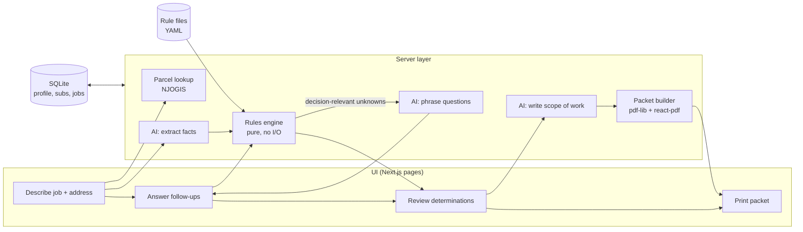

# Permit Packet: Technical Design

| | |
|---|---|
| **Status** | Approved by Gregory Kelly, 2026-10-22 |
| **Author** | Claude (with Gregory Kelly) |
| **Reviewer / approver** | Gregory Kelly |
| **Date** | 2026-10-22 |
| **Inputs** | [Product brief](../product-brief.md) · [Rules table v1](rules-table-v1.md) (approved) · [Test jobs v1](test-jobs-v1.md) (approved) · [Research notes](research-notes.md) |

## 1. Context

Small NJ residential contractors lose time and get applications rejected because of upstream judgment calls: what kind of work this is, which forms apply, what must be approved first, who signs. Permit Packet turns a plain-language job description into a complete, print-ready packet for Maplewood, with every determination explained. The brief covers the problem and user. This document covers how the software is built.

### Goals

- Produce the correct packet (official F100 + technical sections, owner authorization page, scope of work, cover checklist) for the four v1 project types.
- Every determination is **deterministic, explained and cited**: same input → same output, with a reason a contractor can check.
- Uncertain rules are visible assumptions that can be flipped in a config file without code changes.
- Contractor goes from description to printed packet in under 10 minutes.

### Non-goals (v1)

Fee calculation (office's job; [decision](rules-table-v1.md#44-what-the-contractor-fills-in-work-type-cost-and-quantities)), electronic submission, generating plans, the zoning application itself, electronic signatures, towns other than Maplewood, hosting/multi-user.

## 2. Design principle

**AI interprets and writes. Rules decide. The contractor confirms.** This is the core architectural constraint, not just a slogan:

- The AI model never decides tier, forms, zoning or plans. It only turns text into facts, and facts into readable text.
- The rules engine never reads free text. It only reads the structured fact list.
- Nothing reaches the packet until the contractor has confirmed the facts and seen the determinations.

## 3. Architecture



**Components**

| Component | Responsibility | Depends on |
|---|---|---|
| `engine/` | Facts in → determinations out. Pure TypeScript: no network, database, clock or framework. | Rule files only |
| `rules/` | YAML rule data. `state/nj/` and `municipal/maplewood/` kept separate. | Nothing |
| `ai/` | Three Claude API calls: extract, phrase questions, write scope. | Anthropic SDK, fact schema |
| `packet/` | Fill official PDFs, render generated pages, merge into one printable PDF. | pdf-lib, @react-pdf/renderer |
| `parcel/` | Address → block/lot/class/year built via NJOGIS ArcGIS service; returns candidates for the contractor to pick. | HTTP |
| `db/` | Profile, subcontractor directory, jobs. | better-sqlite3 |
| `app/` | Next.js UI and server routes that call the above. | All of the above |

One Next.js project, with the folder boundaries above enforced by a lint rule: `engine/` may not import from anything but `rules/` types. That keeps the engine testable on its own and portable if the UI changes.

## 4. Key interfaces

These two formats are the most important decisions in this document. Everything else can change cheaply. Changing these affects every layer.

### 4.1 Fact list (AI → engine contract)

A job is a property, costs, and a list of **work items**. Each item has a `kind` and kind-specific facts. Every fact that can be unknown is three-valued: a value, or `unknown`. It is never guessed.

```yaml
property:
  address: "34 Oakview Ave, Maplewood NJ"
  block: "16.02"   # from parcel lookup, contractor-confirmed
  lot: "90"
  prop_class: "2"
  year_built: 1925
  dwelling_type: detached_1f      # detached_1f | detached_2f | attached | unknown
costs:                            # contract value by trade, dollars
  total: 48000
  electrical: 5500
  plumbing: 3500
  mechanical: null                # building = total − other trades (CQ-04)
work_items:
  - kind: wall_change
    action: remove
    bearing: no                   # yes | no | unknown
  - kind: fixture
    fixture: sink
    action: relocate              # replace_same | add | relocate
    upsizing_needed: no
  - kind: electrical
    new_outlets: 18
    new_circuits: yes
    service_change: no
  - kind: finishes
    elements: [cabinets, countertops, flooring]
```

About 25 item kinds cover the rules table: finishes, drywall, wall_change, opening, fixture, piping, electrical, appliance, range_hood, exhaust_fan, gas_line, basement_space, insulation, smoke_co_alarm, ductwork, roof, gutters, siding, hvac_equipment, hydronic_piping, chimney_vent, controls, and so on. The schema is written once in TypeScript (with Zod). The same definition validates AI output, drives the UI's confirm screen, and types the engine's input.

### 4.2 Rule files

Each row of the approved rules table becomes one YAML entry, keeping its ID:

```yaml
- id: KB-21
  title: Remove or cut a bearing wall, beam or post
  when:
    kind: wall_change
    bearing: [yes, unknown]          # unknown takes the conservative branch
  then:
    tier: FULL
    forms: [F110]
    plans: sealed
  reason: >
    Cutting a load-bearing wall is excluded from ordinary maintenance
    and isn't minor work.
  citation: "N.J.A.C. 5:23-2.7(b)1–2; 5:23-2.17A(c)1.ii"
```

- **Conditions are a deliberately small language:** equals, one-of, and numeric comparisons (`new_outlets: {lte: 5}`). No code in YAML. If a rule can't be expressed, the language grows deliberately rather than gaining an "escape hatch".
- **Matching:** within a rule group, rules are checked in file order and the first match wins. An item that matches **no** rule is an error. The engine never silently skips work; the app says "can't classify this item, call the office."
- **Assumptions** live in `assumptions.yaml` (ID, text, how to confirm, status). Rules reference them by ID. Flippable ones (e.g. zoning A-13, A-15) are named config values in `municipal/maplewood/config.yaml`.
- **Review stays in table form.** A script renders the YAML back into a markdown table, so the owner reviews rules the same way they did in v1. The YAML is the source of truth from M1 on; `rules-table-v1.md` stays as the approved original.

### 4.3 Determinations (engine output)

One object, used by the review screen, the packet builder and the tests:

`job_tier` · per-item `{rule_id, tier, reason, citation, assumptions}` · `forms` with signer and field entries · `zoning` · `plans` · `tips` · `flags` · `questions` (unknown facts that matter) · `assumptions_applied` · `rules_version`.

`rules_version` is a hash of the rule files, stored with each job. That makes any packet traceable to exactly the rules that produced it.

## 5. How the main flows work

**Choosing follow-up questions.** The engine decides which unknowns matter, not the AI. For each unknown fact, it evaluates the job with each possible value. **If the answers produce different determinations, the fact is decision-relevant and gets asked.** Otherwise it doesn't. The AI only turns the question keys into friendly wording. This makes "asks only questions that change what's required" (brief, step 3) a testable property, not a prompt instruction. If the contractor answers "don't know", the conservative rule applies and the determination says so.

**AI calls.**

| Call | Input | Output | Guardrail |
|---|---|---|---|
| Extract | Description text | Fact list (structured output against the schema) | Schema validation; prompt rule "unknown over guess"; evals score guessed facts as errors |
| Phrase questions | Question keys + relevant facts | Plain-language questions | Engine owns which questions exist |
| Write scope | Confirmed facts + determinations | Scope-of-work narrative for the reviewer | Uses confirmed facts only; contractor edits/approves before printing |

Model: start with `claude-sonnet-5-5` for all three, configurable per call. Evals at M3 decide whether a smaller (Haiku) or larger (Opus) model is the better fit for each call. The API key comes from `ANTHROPIC_API_KEY` and is never committed.

**Data sent to the API:** only the job description and the job's facts. The contractor profile, license numbers, owner contact details and FEIN never leave the machine.

**Packet building.** Official fillable PDFs are downloaded from DCA and stored in `assets/forms/` with their revision dates (F100 rev. 8/23; tech sections rev. 12/25). A field-map file per form connects our fields to the PDF's field names. pdf-lib fills and flattens them. Generated pages (cover checklist, owner authorization, scope of work, "no permit needed" sheet) are rendered with @react-pdf/renderer. Everything is merged into one PDF in print order.

**Parcel lookup.** Query NJOGIS by municipality + normalized street, return candidates (address, block, lot, qualifier, class, year built), and the contractor picks and confirms. Results are cached in SQLite. Owner name is redacted in the source data (Daniel's Law), so it's entered by the contractor.

## 6. Alternatives considered

| Decision | Chosen | Rejected | Why |
|---|---|---|---|
| Who decides permit requirements | Deterministic rules engine | Let the AI decide from the description | Determinations must be repeatable, cited and testable; a permit applicant certifies the result. AI is used where language is the problem, not where judgment must be auditable |
| Rules representation | Data (YAML) | Rules written as code | Owner can read and edit; a wrong assumption is a one-line fix; a second town is new data, not new logic |
| Which questions to ask | Engine computes decision-relevant unknowns | AI decides what to ask | Testable; prevents both missing and unnecessary questions |
| Forms | Fill the official DCA PDFs | Generate lookalike forms | Offices expect official forms; fewer rejection risks; revisions are tracked |
| Fees | Not calculated | Estimate from Maplewood ordinance | Fee boxes are office use only; ordinance is ambiguous in 9 places; a wrong estimate costs trust. Schedule kept for v2 |
| Build order | Engine first, UI last | Full app first | Core value is the determinations; engine can be proven correct before anything else exists |
| App framework | Next.js (one project, UI + server) | Separate API + SPA; CLI only | One project to run locally; server code keeps the API key off the browser. Trade-off: heavier than strictly needed |
| Storage | SQLite (better-sqlite3, plain SQL) | JSON files; Postgres; an ORM | Single local file, real queries, no server. Plain SQL keeps concepts minimal for a small schema |
| Generated pages | @react-pdf/renderer | Headless browser (Playwright) print; drawing with pdf-lib | Pure JS, no browser install; easier layout than drawing text by hand |

## 7. Testing strategy

| Layer | Method | Pass criteria |
|---|---|---|
| Rules engine | Vitest. The 10 approved test jobs (+ J-05b) as YAML fixtures, plus unit cases for the gaps the test doc lists (out of scope, LC-01, LC-05, KB-21, KB-24, HV-02, "don't know" answers) | Exact match on tier, per-item rule IDs, forms, signers, form entries, zoning, plans, tips, flags. Fixed date 2026-10-22 |
| Question selection | Unit tests over fixtures with facts removed | Exactly the expected questions are asked: no more, no fewer |
| Rule data | Schema validation of every YAML file; every rule ID in the rules table exists; every assumption referenced exists | All files valid |
| AI extraction | Eval suite over the 10 descriptions, scored, not pass/fail | Decision-relevant facts correct; **zero guessed facts** (a wrong value where `unknown` was right counts as a failure). Targets set at M3 |
| Scope narrative | Owner review of samples + automated check that no fact appears that isn't in the confirmed list | Owner approves |
| PDF filling | Automated: fill, then read the fields back from the PDF and compare to expected entries. Manual: print and check | Fields match; printed packet approved |
| End to end | Owner times a full job in the app | Under 10 minutes (brief's definition of done) |

Expected answers change only with owner review. A test fixture edit is a rules change and is called out as such.

## 8. Risks

| Risk | Mitigation |
|---|---|
| Rules are wrong (no local checklist) | Assumptions register surfaced in-app; construction office call list (rules table §6); rules are cheap to edit |
| AI guesses a fact | Unknown-by-default schema; evals penalize guesses; contractor confirms every fact |
| DCA revises a form or renames fields | Store form revision; field read-back tests fail loudly; check the DCA forms page before each release |
| Item matches no rule | Engine errors instead of skipping; covered by tests |
| Parcel address mismatch | Show candidates; contractor confirms |
| Office wants copies or ordering we don't know | DCA forms page says one original plus three copies; confirm with Maplewood and add to the cover checklist |

## 9. Milestones

Each milestone ends with an owner review of working output. No timelines by design.

| # | Milestone | Done when | Owner reviews |
|---|---|---|---|
| M1 | Rule files, fact schema, engine, test fixtures | All engine and question-selection tests pass | Rendered rules table from YAML; test report |
| M2 | Packet builder | Field read-back tests pass for all MW/FULL test jobs | Printed packets for J-01, J-04, J-08 |
| M3 | AI layer | Eval report meets agreed targets | Eval report; sample questions and scope narratives |
| M4 | App: profile, subs, parcel lookup, the four screens | A test job runs end to end in the app | A timed run-through (< 10 min) |
| M5 | Polish from contractor feedback | | |

**Workflow per milestone:** short plan → owner approval → work on a branch, tests first → show output → merge. `CLAUDE.md` records where we are so any session can resume.

## 10. Review decisions (2026-10-22)

1. **Interfaces (§4):** fact list and rule file formats approved.
2. **Next.js:** kept (§6).
3. **Rules review format:** from M1 on, rules are reviewed as a table generated from the YAML files; `rules-table-v1.md` stays as the approved original.
